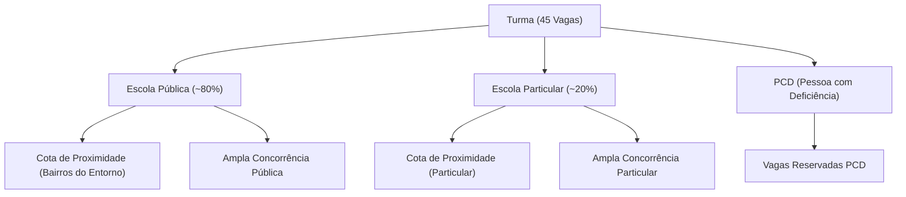
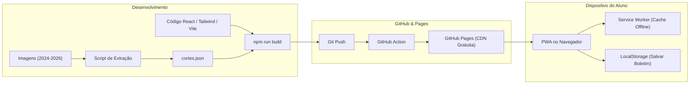

# Plano de Desenvolvimento — EEEP Orienta (PWA)

Este documento especifica a arquitetura completa, regras de negócio do processo seletivo das EEEPs, pipeline de dados das listas de classificação (2024, 2025 e 2026), motor estatístico de chances e o plano de implementação do PWA para hospedagem no **GitHub Pages**.

---

## 1. Regras de Negócio do Processo Seletivo EEEP

### 1.1. Cálculo da Média de Entrada do Aluno
Conforme as diretrizes das Escolas Estaduais de Educação Profissional (EEEPs):
* **Período**: 4 anos do Ensino Fundamental II (**6º, 7º, 8º e 9º Ano**).
* **9 Disciplinas Obrigatórias**:
  1. Artes
  2. Ciências
  3. Educação Física
  4. Ensino Religioso
  5. Geografia
  6. História
  7. Inglês
  8. Matemática
  9. Língua Portuguesa
* **Cálculo da Média**:
  $$\text{Média do Ano } A = \frac{\sum_{d=1}^{9} \text{Nota}_{d, A}}{9}$$
  $$\text{Média Final do Candidato} = \frac{\text{Média}_{6º} + \text{Média}_{7º} + \text{Média}_{8º} + \text{Média}_{9º}}{4} = \frac{\sum_{i=1}^{36} \text{Nota}_i}{36}$$
  *(Calculada com 2 casas decimais e arredondamento padrão do edital).*

> [!TIP]
> **Modo Duplo de Entrada no App**:
> O estudante poderá escolher entre:
> 1. **Modo Rápido**: Digitar diretamente a Média Final (caso já possua o cálculo emitido pela escola).
> 2. **Calculadora Completa do Histórico**: Uma grade intuitiva de preenchimento dos 4 anos $\times$ 9 matérias, com cálculo automático instantâneo e detecção de notas faltantes.

---

### 1.2. Mapeamento de Vagas e Modalidades de Concorrência
Em cada turma de **45 vagas**, as vagas são distribuídas por cotas de acordo com a origem escolar e condições específicas:



| Modalidade de Concorrência | Chave no Sistema | Descrição no Edital | Média Típica de Vagas |
| :--- | :--- | :--- | :---: |
| **Pública — Proximidade** | `pub_proximidade` | Alunos de escola pública residentes no raio/bairros vizinhos | 10 a 12 |
| **Pública — Ampla** | `pub_ampla` | Demais alunos de escola pública | 23 a 25 |
| **Particular — Proximidade** | `part_proximidade`| Alunos de rede particular com cota territorial | 2 a 3 |
| **Particular — Ampla** | `part_ampla` | Demais alunos de escola particular | 6 a 7 |
| **PCD** | `pcd` | Candidatos com deficiência comprovada | 2 |

---

## 2. Pipeline de Engenharia de Dados (2024, 2025, 2026)

### 2.1. Inventário das Listas Existentes
O projeto já conta com as imagens de resultados:
* **2024**: Informática, Enfermagem, Turismo, Agroindústria.
* **2025**: Informática, Enfermagem, Turismo, Agroindústria.
* **2026**: Informática, Enfermagem, Turismo (e verificação de Agroindústria).

### 2.2. Extração Estruturada e Validação
Cada imagem será digitalizada e convertida para um formato tabular JSON com a seguinte estrutura:

```json
{
  "ano": 2026,
  "curso": "Enfermagem",
  "total_vagas": 45,
  "modalidades": {
    "pub_ampla": {
      "vagas": 24,
      "maior_nota": 9.72,
      "nota_corte": 9.30,
      "media_modalidade": 9.47,
      "candidatos": [
        {"posicao": 1, "media": 9.72},
        {"posicao": 24, "media": 9.30}
      ]
    },
    "pub_proximidade": {
      "vagas": 10,
      "maior_nota": 9.23,
      "nota_corte": 8.74,
      "media_modalidade": 9.00
    }
  }
}
```

> [!IMPORTANT]
> **Garantia de Não Alucinação / Verificação Cruzada**:
> 1. Todas as notas serão ordenadas decrescentemente;
> 2. A última nota de cada modalidade define a **Nota de Corte Real** daquele ano;
> 3. Os nomes dos candidatos serão omitidos ou abreviados no JSON final por conformidade com a LGPD.

---

## 3. Modelo Matemático para Cálculo de Chance de Ingresso

Para que o percentual não seja uma mera estimativa empírica vaga, aplicaremos um modelo estatístico calibrado sobre o histórico dos 3 anos:

### 3.1. Variáveis Consideradas
1. **$N$**: Nota (média final) do estudante.
2. **$C_{t}$**: Notas de corte dos anos anteriores ($t \in \{2024, 2025, 2026\}$) para o curso e cota selecionados.
3. **$\bar{C}_{proj}$**: Corte projetado ponderado:
   $$\bar{C}_{proj} = 0.50 \cdot C_{2026} + 0.30 \cdot C_{2025} + 0.20 \cdot C_{2024}$$
4. **$\sigma_C$**: Volatilidade (desvio padrão) do corte ao longo dos anos.
5. **Margem $\Delta$**: Diferença entre a nota do aluno e o corte projetado:
   $$\Delta = N - \bar{C}_{proj}$$

### 3.2. Função de Probabilidade Sigmoide Calibrada
$$P(\text{Aprovação}) = \frac{100}{1 + e^{-k \cdot (\Delta / s)}}$$
* Onde:
  * $s = \max(\sigma_C, 0.15)$ (ajusta a sensibilidade à variação de cada curso).
  * $k \approx 3.5$: Se a nota do aluno for exatamente igual ao corte estimado ($\Delta = 0$), a probabilidade calculada é de **50%** (empate técnico no limite das vagas).
  * Se $\Delta \ge +0.25$, a chance sobe para **$\ge 85\%$**.
  * Se $\Delta \le -0.25$, a chance decresce para **$\le 15\%$**.

### 3.3. Classificação Semântica para o Usuário
* 🟢 **Chance Muito Alta ($\ge 85\%$)**: Média acima de todos os cortes históricos recentes.
* 🟡 **Zona de Concorrência / Disputa ($50\% - 84\%$)**: Média dentro da margem de oscilação do corte; boa chance de vagas imediatas ou 1ª chamada de lista de espera.
* 🟠 **Zona de Espera ($25\% - 49\%$)**: Média ligeiramente abaixo do corte recente; depende de sobra de vagas e chamadas posteriores.
* 🔴 **Chance Baixa ($< 25\%$)**: Média historicamente distante do corte da modalidade.

---

## 4. Arquitetura Técnica do PWA (GitHub Pages)



### Tecnologias Selecionadas:
* **Framework**: React com **Vite** (geração de bundle estático ultra-otimizado $< 150\text{ KB}$).
* **Estilização**: **Tailwind CSS** com suporte a modo claro/escuro e layout pensado para smartphones (mobile-first).
* **PWA Plugin**: `vite-plugin-pwa` para geração automática de `manifest.json`, ícones e Service Worker com estratégia *Cache First*.
* **Gráficos**: Componentes SVG interativos (termômetros de chance e comparativo histórico de barras ano a ano).

---

## 5. Estrutura de Telas do Aplicativo

1. **Tela 1: Perfil de Concorrência do Aluno**
   * Seleção de Origem Escolar: `Escola Pública` ou `Escola Particular`.
   * Pergunta de Territorialidade: `Mora em bairro de cota de proximidade? (Sim/Não)`.
   * Pergunta PCD: `Concorre como Pessoa com Deficiência (PCD)? (Sim/Não)`.

2. **Tela 2: Lançamento de Notas**
   * Alternador: `[Digitar Média Pronta]` ou `[Preencher Boletim dos 4 Anos]`.
   * No modo Boletim: Tabela colapsável por ano (6º, 7º, 8º, 9º) com as 9 matérias e média instantânea em destaque.

3. **Tela 3: Painel de Resultados (Simulação em Tempo Real)**
   * Cards para cada curso ofertado:
     * **Enfermagem**
     * **Informática**
     * **Turismo**
     * **Agroindústria**
   * Em cada card:
     * **Termômetro visual de Chance (%)** e badge (`Alta`, `Média`, `Baixa`);
     * Histórico do corte daquela cota em 2024, 2025 e 2026;
     * Distância da nota do aluno para o último corte registrado;
     * Dicas personalizadas (ex: recomendação de curso de menor corte caso a média esteja apertada).

---

## 6. Fases de Execução

- [ ] **Fase 1**: Extração completa e auditoria das notas das imagens de 2024, 2025 e 2026 $\to$ Geração do `dataset_cortes.json`.
- [ ] **Fase 2**: Criação do projeto Vite + React + Tailwind + PWA configurado para GitHub Pages.
- [ ] **Fase 3**: Implementação dos componentes da Calculadora de 36 Notas e Perfil de Cota.
- [ ] **Fase 4**: Implementação do Motor de Simulação Estatística e Termômetro de Chances.
- [ ] **Fase 5**: Configuração do Service Worker para suporte Offline e automação do deploy no GitHub Actions.
